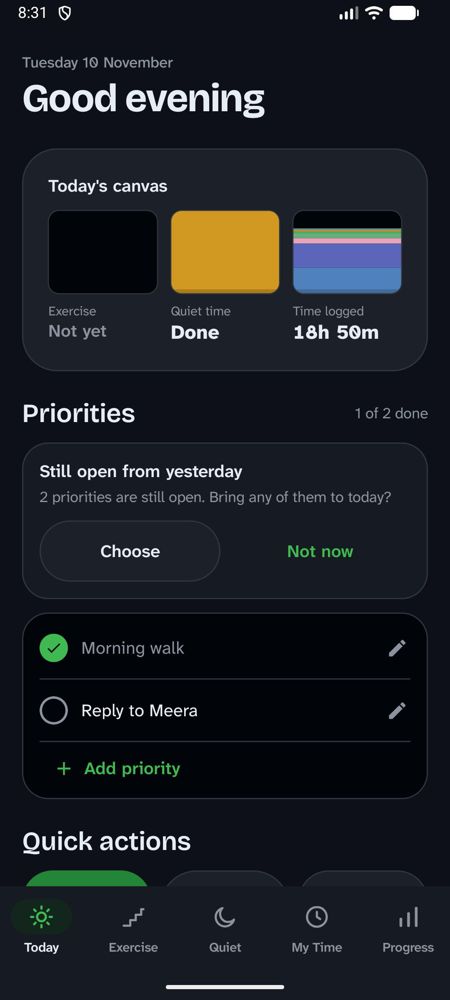
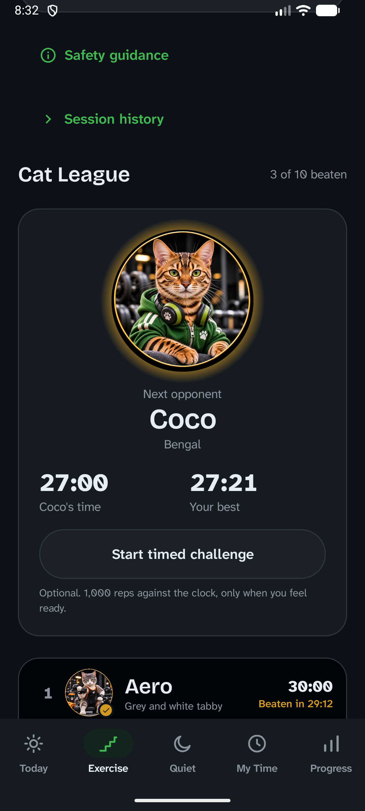
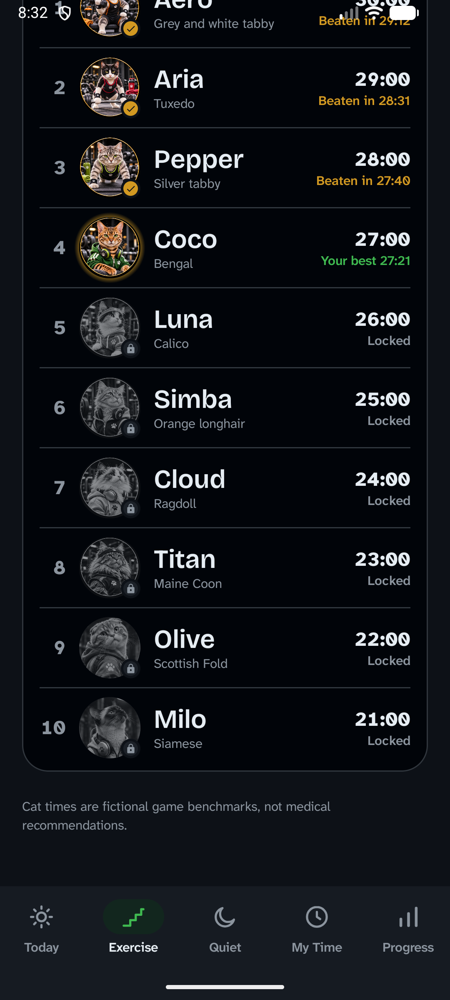
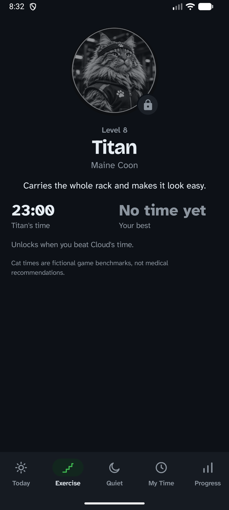
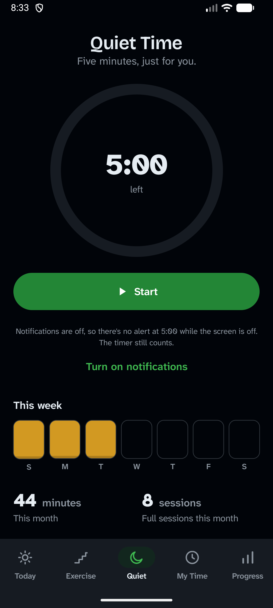
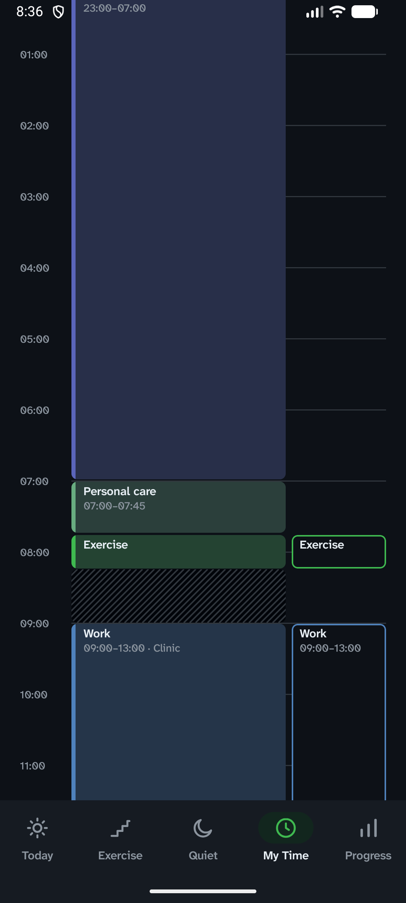
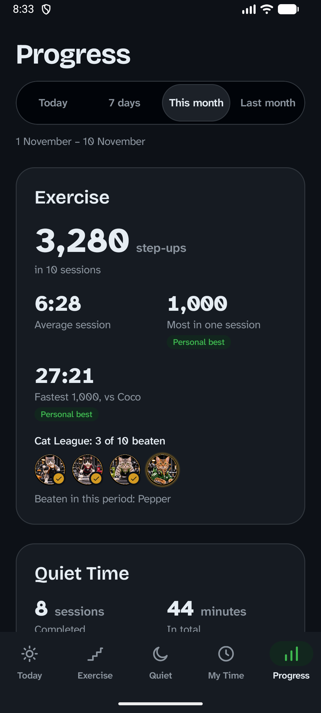

# Paint Life

Offline Android companion for daily movement, five minutes of quiet,
and knowing where your time goes.

- **Today** – up to three priorities and a calm daily overview
- **Exercise** – step-up counter and the Paint Life Cat League
- **Quiet Time** – a five-minute daily timer
- **My Time** – a 24-hour timeline of where the day actually goes
- **Progress** – weekly and monthly reports, no guilt

No account, no ads, no internet. All data stays on the device.

Built with Kotlin, Jetpack Compose, Material 3, Room and DataStore. Dark theme only.
Status: version 1.1.0, all 8 iterations complete, plus one-tap Sleep and Wake up buttons (Iteration 9). Minimum Android 8.0 (API 26).

## Screenshots

Taken from the signed release build on an emulator, with invented demo data.

| Today | Cat League | League ladder | Cat detail |
|---|---|---|---|
|  |  |  |  |

| Quiet Time | My Time | Progress |
|---|---|---|
|  |  |  |

To retake them: run `python docs/demo/make_demo.py demo.json <now in epoch ms>` (the data is
written relative to "now", in Asia/Kolkata), copy the file to an emulator, and load it with
**Progress → Your data → Import backup**. Never use a phone with real data for this.

## Your data

Everything stays on the phone. Android's automatic backup is off, so data leaves the device only
when you choose **Progress → Your data → Export backup**, which saves one JSON file wherever you
pick. **Import backup** reads such a file, shows what it holds and what is on the phone, and
replaces everything only after you confirm.

The app asks for one permission, notifications (for the Quiet Time timer and its 5:00 alert), and
works without it.

## Design gallery (debug builds only)

Debug builds show a small bug icon in the top-right corner. Tap it, then **Design gallery**, to
review every component and all five screens in labelled sample states. Each sample carries a
"Sample" badge. Release builds have no gallery and no sample data.

## Cat pictures

The ten Cat League cats, in level order: Aero, Aria, Pepper, Coco, Luna, Simba, Cloud, Titan,
Olive and Milo (the champion). Their pictures are bundled in the app; nothing is downloaded.

Cat art: Pooja / Maukingdom, created with ChatGPT.

To replace a picture:

1. Put the new one in `art/cats/` under its existing name (`01_aero.png`, `02_aria.png`,
   `03_pepper.png`, `04_coco.png`, `05_luna.png`, `06_simba.png`, `07_cloud.png`, `08_titan.png`,
   `09_olive.png`, `10_milo.png`). This folder is not packaged into the app.
2. Crop it to a centred square, resize to 640×640 and save as WebP (quality about 85) over
   `app/src/main/res/drawable-nodpi/cat_<name>.webp`, e.g. `cat_aero.webp`. With ffmpeg:
   `ffmpeg -i art/cats/01_aero.png -vf "crop='min(iw,ih)':'min(iw,ih)',scale=640:640:flags=lanczos" -c:v libwebp -q:v 85 app/src/main/res/drawable-nodpi/cat_aero.webp`
3. If a face sits off-centre in the circle, set `photoAlignment` for that cat in
   `exercise/cats/CatRoster.kt`.

No code changes are needed. The pictures carry their own gold ring, so the app draws none.
Olive and Milo (09, 10) are lower-resolution for now and will be replaced.

## Build

Requirements: JDK 25 installed (Gradle runs on it), Android SDK with platform 37 and
build-tools 36.0.0. Android Studio 2026.2.2 or newer works.

```sh
./gradlew assembleDebug testDebugUnitTest lintDebug
```

- Gradle picks JDK 25 automatically through `gradle/gradle-daemon-jvm.properties`, whatever
  `java` is first on your PATH. JDK 25 must be installed locally (no auto-download is configured).
- `local.properties` (gitignored) holds `sdk.dir` if `ANDROID_HOME` is not set.
- All tests, including Room and Compose UI tests, run on the JVM through Robolectric.
- The debug APK is written to `app/build/outputs/apk/debug/app-debug.apk`.

### Windows: home folder with a space

Robolectric mis-encodes spaces in its Maven cache path. If your user folder contains a space,
add a space-free path (the 8.3 short name works) to your **user** `~/.gradle/gradle.properties`:

```properties
paintlife.robolectric.mavenRepoLocal=C:/Users/SHORTN~1/.m2/repository
```

### Release build

Release builds are signed with your own keystore and never fall back to the debug key.
Copy `keystore.properties.example` to `keystore.properties` (gitignored) and fill it in, or set
`PAINTLIFE_STORE_FILE`, `PAINTLIFE_STORE_PASSWORD`, `PAINTLIFE_KEY_ALIAS` and
`PAINTLIFE_KEY_PASSWORD`. Then run `./gradlew assembleRelease`.

To create a keystore (kept outside the repository; back it up, because updates to an installed
app must be signed with the same key):

```sh
keytool -genkeypair -v -keystore ../keys/paint-life-release.jks -storetype PKCS12 -alias paint-life -keyalg RSA -keysize 4096 -validity 10000
```

The APK is written to `app/build/outputs/apk/release/app-release.apk`. Check who signed it with
`apksigner verify --print-certs app/build/outputs/apk/release/app-release.apk` (apksigner is in
the Android SDK's `build-tools`). Install it with `adb install -r <apk>`, or copy it to the phone
and open it.

## Licences and credits

- Code: see `LICENSE`.
- Fonts: Bricolage Grotesque and Atkinson Hyperlegible Next, SIL Open Font License
  (`docs/licenses/`).
- Icons: Material icon shapes, Apache 2.0.
- Cat art: Pooja / Maukingdom, created with ChatGPT.
